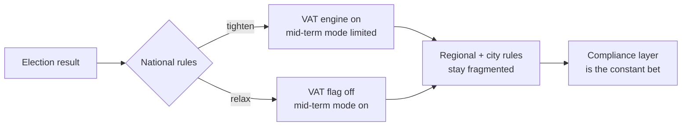

# The Scenarios · STR Europe

> Module 4 · Political risk. How the Spanish election and the hotel "level playing field" debate could reshape the market, and how to build for any outcome.

_Neutral analysis of stated party positions as of 18 November 2026. Not a forecast._

## Spain after 29 November 2026

**Stated positions**

- **PSOE / Sumar (current government):** higher taxes on tourist flats, regulation of seasonal and room rentals. [Source](https://brainsre.news/?p=316467)
- **PP:** supply-led housing plan (one million homes); no national tourist-flat proposal in its programme; Feijóo prefers deciding "city by city". [Source](https://www.eldiario.es/1_d09022)
- **Vox:** repeal of the Housing Law, deterrent taxes on non-EU buyers and speculative funds, and regulating the spread of tourist flats. [Source](https://www.articulo14.es/politica/programa-electoral-de-vox-para-las-elecciones-del-29n-propuestas-sobre-vivienda-inmigracion-sanidad-y-pensiones-20261116.html)

**What a PP-led government would likely change**

| Area | Likely direction | Effect on hosts |
|---|---|---|
| 21% VAT | Shelved | Relief |
| Consumer-ministry enforcement | Softer | Lower fine risk for platforms |
| Housing Law / rent caps | Repealed | Some owners return to long-term renting |
| Seasonal-let regulation | Dropped | Mid-term stays viable longer |
| Regional and city rules | Unchanged | No relief where it hurts most |

**The Portugal pattern.** National rules relax, power moves to municipalities, local rules tighten. Build for that.

_____

## Hotels vs STRs: the "level playing field"

Parity bundles five choices: tax, safety standards, land use, operations, registration. The likely endgame is a **two-tier system**:

- **Tier 1, home-sharing:** light-touch. The EU's proposed Affordable Housing Act already excludes primary residences.
- **Tier 2, professional units:** treated more and more like hotels.

**Evidence on effects.** After New York's enforcement, hotel rates rose an estimated $14–$19 a night. [Source](https://www.hotelmanagement-network.com/features/hotels-vs-short-term-rentals-in-paris-barcelona-new-york-and-london/) Whether housing improves is disputed.

**Tax detail.** True parity is 10% VAT with deductions; 21% goes beyond parity. Even the hotel federation asked to keep current accommodation VAT. [Source](https://cehat.com/wp-content/uploads/2024/11/13.11.2024-CEHAT-advierte-sobre-los-riesgos-de-una-subida-del-IVA-al-21-en-las-viviendas-turisticas.pdf)

_____

## Building for any outcome

- Region-level rule configuration and feature flags, so a change of government means a configuration change, not a rebuild.
- The real signal is the coalition agreement, not election night.
