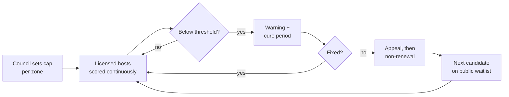

# The Concept · STR Europe

> Module 5 · GoodHost Score. Performance-based caps instead of blanket bans.

## The idea

In saturated areas, a licence becomes a permit you keep by behaving well, not a perpetual asset. Hosts who don't comply lose their slot at renewal, and the next candidate on a public waitlist takes it.

_____

## Two layers, two owners

**Layer 1 · GoodHost Score (the platform owns it)**

| Signal | Examples |
|---|---|
| Compliance | Valid licence, guest-registry submissions on time, tourist tax filed, insurance and safety certificates current |
| Neighbourhood impact | Noise alerts (decibels only, never audio), verified complaints and time to resolve, occupancy violations |
| Activity | Unit actually operating (no "ghost" licences) |
| Guest experience | Reviews, response time, cancellations |

Uses: ranking on direct-booking sites, a "verified good host" badge, portfolio health for PMs, input for insurers.

**Layer 2 · Cap-and-waitlist engine (the council decides, the platform supplies the software)**

_____

## Legal guardrails

1. **EU Services Directive:** scarce authorisations need impartial, transparent, publicised selection, limited duration and no automatic renewal. A waitlist fits this better than "first come, forever".
2. **Time-limited licences only:** revoking perpetual licences on a score would face property-rights challenges. Works where licences already expire, or for new fixed-term licences.
3. **No discrimination by nationality or residency.**
4. **GDPR:** a score with significant effects needs transparency, human review and data minimisation.
5. **Due process:** published criteria, notice, cure period, appeal.

_____

## Who wins, who loses

| Stakeholder | Effect |
|---|---|
| Compliant hosts | An alternative to blanket bans: keep the licence on merit |
| Non-compliant hosts | Lose their slot |
| Investors | Licence = renewable permit; less speculation |
| Waitlisted hosts and locals | A fair, visible path to entry |
| Neighbours and councils | Behaviour lever + hard cap |
| Guests | A trust signal |

_____

## Risks

- **Customer backlash:** frame and build it as protection for good hosts, with coaching and early warnings before penalties.
- **Gaming:** multiple data sources, verified complaints, anomaly detection.
- **Liability:** contractual allocation of responsibility, audit trail, explainable scores.
- **Conflict of interest:** strict data separation or an independent auditor if the platform both runs the engine and sells to hosts.

_____

## Rollout

1. **Phase 1:** private score for platform customers (health view, badges, coaching).
2. **Phase 2:** read-only responsible-growth dashboard for a pilot council.
3. **Phase 3:** cap-and-waitlist pilot with a council that issues time-limited licences, with legal review and an independent auditor.
