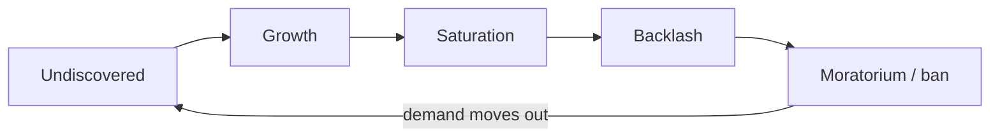

# The Expansion · STR Europe

> Module 6 · Emerging destinations. Growth outside saturated cities, without exporting the problem.

## Why it holds

- **Room to spread demand.** Only 12.7% of international arrivals to Spain in 2025 went outside the main destinations. [Source](https://www.mallorca.com/en/magazin/news/spain-tourism-plan-overlooked-regions)
- **Rentals are the infrastructure.** Around 75% of rural Spanish municipalities have no hotel. [Source](https://www.idealista.com/en/news/lifestyle-in-spain/2026/01/28/881729-august-2026-solar-eclipse-rural-rentals-surge)
- **Policy tailwind.** Spain's 2030 tourism strategy aims to spread visitors more widely and encourage slower, longer stays. [Source](https://www.euronews.com/2026/09/16/spain-sets-out-2030-sustainable-tourism-strategy-with-residents-a-core-focus)
- **Crowded space.** Airbnb committed €40M over three years to rural Spain. [Source](https://www.thespanisheye.com/2025/11/18/airbnb-reveals-e40m-plan-to-invest-in-rural-spain-after-crackdowns-in-major-cities/) A host platform won't win on demand; it wins on operations and compliance.

_____

## The regulatory lifecycle

Regulation follows the listings outward. Barcelona's ban is extending across its metropolitan area. [Source](https://www.eldebate.com/espana/cataluna/barcelona/20260309/prohibicion-pisos-turisticos-impulsada-barcelona-extiende-toda-area-metropolitana_392923.html) Málaga city lost listings while the Axarquía and Serranía de Ronda grew. [Source](https://www.elespanol.com/malaga/20260625/regulacion-empieza-tumbar-boom-vivienda-turistica-malaga-ano/1003744298178_0.html)

The product goal: keep destinations in "Growth" with early warnings, so they never reach "Backlash".

_____

## Where a host platform wins

1. **Destination radar:** score municipalities on regulatory headroom, demand growth, supply gap, access and seasonality, with saturation warnings.
2. **Rural-host product:** multilingual AI messaging, simple Spanish onboarding, compliance built in, entry-level price. Distribution through rural tourism associations.
3. **Remote operations:** cleaning routes, smart locks, local maintenance networks for dispersed portfolios.
4. **Local experiences in direct booking:** routes, wineries, gastronomy, transfers.
5. **Event-driven pricing:** festivals, pilgrimages, eclipses.
6. **Council partnerships:** responsible-growth dashboards (see [`05-concept`](../05-concept/goodhost-score.md)).
7. **Slow-travel features:** weekly and monthly pricing, mid-stay cleaning, workspace information.

_____

## Pilot candidates (named by Turespaña)

| Destination | Why | Check |
|---|---|---|
| **Castilla y León** (historic towns, Guadarrama north side, part of Picos) | One regional regime, high-speed rail access, rural-population priorities | First choice |
| Picos de Europa | Nature, families, longer stays | Three regional rulebooks |
| Pyrenees | All-season slow travel | Catalan side under stricter regime; verify Aragón |

_____

## Guardrails

- Spread demand within destinations (many towns, modest density), never concentrate it.
- Compliance and neighbour tools on by default from day one.
